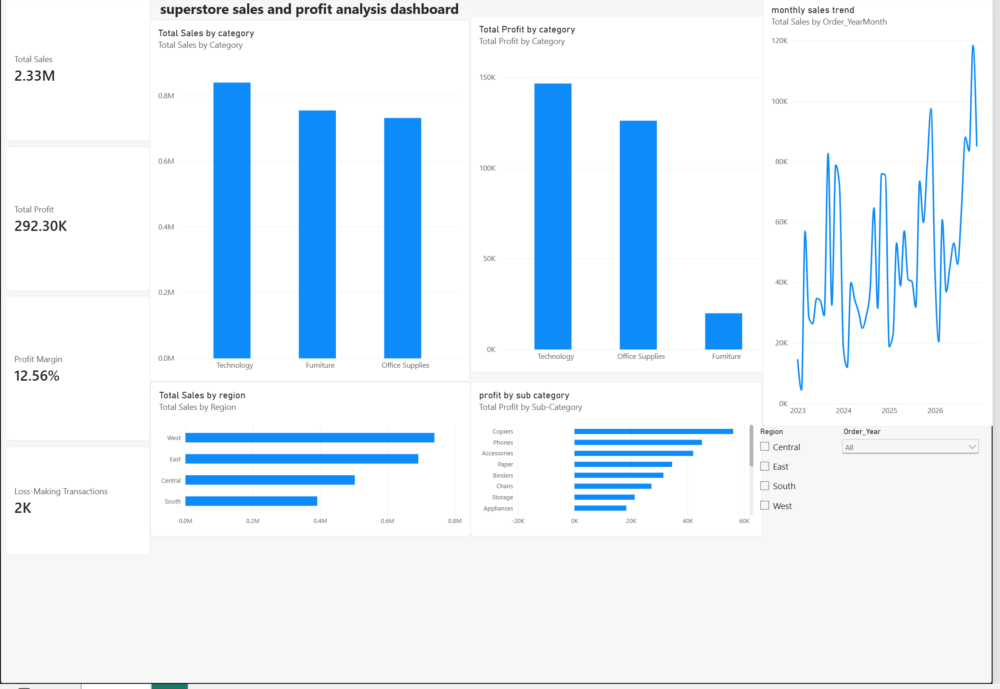

# Superstore Sales & Profit Analysis

## Project Overview
An interactive Power BI dashboard analyzing retail sales, profitability, regional performance, and loss-making transactions using a Superstore dataset.

## Tools Used
- Power BI
- DAX
- Python
- Data Cleaning and Preparation

## Dashboard


## Key Metrics
- Total Sales: $2.33M
- Total Profit: $292.30K
- Profit Margin: 12.56%
- Loss-Making Transactions: Approximately 2K

## Analysis
- Sales and profit by product category
- Sales performance by region
- Profitability by product sub-category
- Monthly sales trends
- Interactive region and year filters

## DAX Measures

```dax
Profit Margin =
DIVIDE([Total Profit], [Total Sales], 0)
```

```dax
Loss-Making Transactions =
CALCULATE(
    COUNTROWS('superstore_clean'),
    'superstore_clean'[Profit] < 0
)
```

## Business Insights
- Technology generates the highest overall sales and profit.
- The West region leads in total sales.
- Furniture has comparatively low profit despite strong sales.
- Regional and year filters support performance comparisons.

## Project Files
- Power BI dashboard (.pbix)
- Project report (.docx)
- Raw and cleaned datasets
- Python data quality script
- Dashboard screenshot
- 
This project demonstrates practical data analytics and business intelligence skills.

